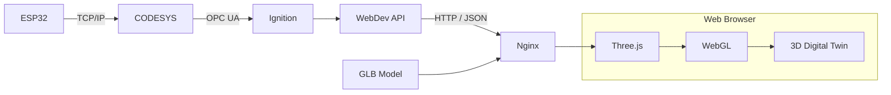

# xy-plotter-softplc-ignition
Open-source automation project for an XY plotter.

**Industrial automation demonstrator built around Raspberry Pi 5, CODESYS SoftPLC, Ignition Perspective, PostgreSQL, ESP32 motion control, and an interactive Three.js Digital Twin.**

This repository documents the next stage of my XY Plotter automation project: replacing a traditional Siemens PLC and dedicated HMI architecture with an integrated, Linux-based edge control platform.

The objective is not simply to operate an XY plotter, but to explore how **PLC-based machine coordination, SCADA, drawing management, diagnostics, and historical data** can work together on a compact industrial-style automation platform.

> **Previous project / fundamentals:** For the original Siemens S7-1200 + KTP700 architecture, mechanical and electrical design, ESP32 motion-control fundamentals, and introductory documentation, see **[XY Plotter Automation — Original Project](https://github.com/shevtsovandreas/xy-plotter-automation)**. This repository focuses on the **new SoftPLC and Ignition implementation**, its additional functionality, and technical details.

## What's New

The original system used a Siemens S7-1200 PLC, KTP700 Basic HMI, and a separate PC workflow for preparing and transferring drawing data.

The updated system brings machine coordination, operator visualization, and data storage together on a **Raspberry Pi 5**:

| Layer | Technology | Responsibility |
|---|---|---|
| Machine control | CODESYS SoftPLC | Operating modes, sequencing, interlocks, and communication with the motion controller |
| SCADA / HMI | Ignition Gateway + Perspective | Browser-based operator interface, drawing management, visualization, diagnostics, and history |
| Data storage | PostgreSQL | Drawing catalog, G-code/SVG data, configuration, alarm and signal catalogs, execution history, and events |
| Motion control | ESP32 + W5500 Ethernet | Buffered XY trajectory execution, interpolation, and STEP/DIR pulse generation |
| Operator access | Web browser | Access to the Perspective interface from a client device |
| Digital Twin | Three.js + WebGL | Interactive 3D machine visualization and live trajectory rendering |
| HTTP API | Ignition WebDev | Live machine feedback for the Digital Twin |
| Web server | Nginx | Static file hosting and reverse proxy |

## System Architecture

The **Raspberry Pi 5** hosts CODESYS SoftPLC, Ignition Gateway, and PostgreSQL.

- **PostgreSQL ↔ Ignition:** JDBC for drawing and configuration data, execution records, and alarm/event logging.
- **Ignition ↔ CODESYS:** OPC UA for commands, G-code/trajectory transfer, machine status, and diagnostics.
- **CODESYS ↔ ESP32:** Ethernet TCP/IP for motion commands and controller feedback.
- **Browser ↔ Ignition:** HTTP/HTTPS for the Perspective operator interface.

The software PLC manages the machine sequence, while time-critical motion execution remains on the ESP32. The ESP32 uses a **256-point circular buffer**, Bresenham XY interpolation, and a **10 µs timer interrupt** for STEP/DIR pulse generation.

The Digital Twin version extends this architecture with Nginx, Ignition WebDev, and a browser-based Three.js application.

The 3D visualization runs directly in the client browser, while the Raspberry Pi hosts the application files and provides live machine feedback through an HTTP API.

The existing PLC and ESP32 control architecture remains unchanged.

## Ignition Perspective Features

The SCADA project is organized into dedicated operator views:

| View | Functionality |
|---|---|
| **Auto** | Drawing execution, process monitoring, and live trajectory visualization |
| **Library** | Import, browse, select, activate, and manage drawings; G-code/SVG handling |
| **Manual** | Jog controls, homing, pen operation, and target-position movement |
| **I/O** | Machine signals, controller status, and diagnostic information |
| **Alarms** | Alarm display and event history |
| **History** | Drawing execution records and results |

### Drawing Management

Drawings are managed through the SCADA application rather than a separate PC-side transfer tool. The database stores drawing metadata and parameters alongside G-code and SVG representations. Operators can maintain a catalog of drawings and select the one to execute.

### G-code Processing and Transfer

Ignition project scripts handle G-code parsing, SVG generation/preview, and transfer of drawing data to the SoftPLC. The PLC coordinates the point-by-point interface with the ESP32 motion controller.

### Diagnostics and Traceability

The project includes named queries and scripts for alarm catalogs, signal catalogs, communication logs, and drawing execution history. The Perspective interface exposes machine status and diagnostic information to the operator.

## Digital Twin — Interactive 3D Visualization

The project includes an interactive 3D Digital Twin integrated
into the Ignition Perspective operator interface.

The Digital Twin uses actual machine feedback to visualize
the physical XY Plotter in the browser.

### Features

- Live X/Y axis position visualization
- Pen and servo movement animation
- Live drawing trajectory rendering
- Interactive camera rotation, zoom, and navigation
- Integration with the Ignition Perspective Auto screen

### Technologies

| Technology | Responsibility |
|---|---|
| Three.js | 3D scene and object manipulation |
| WebGL | Hardware-accelerated 3D rendering |
| GLB / glTF | 3D machine model |
| Ignition WebDev | HTTP API for live machine feedback |
| Nginx | Static file hosting and reverse proxy |
| JavaScript | Data polling and model synchronization |

The 3D model is loaded into browser memory during application initialization. Machine feedback is retrieved from Ignition
approximately every 100 ms and used to update the position and orientation of the corresponding 3D objects.

The Digital Twin is used for visualization only and does not send control commands to the PLC or ESP32.

For more information:

- [Digital Twin documentation](documentation/digital-twin/README.md)
- [Source code and deployment instructions](software/digital-twin/README.md)

## Communication Overview

| Link | Protocol | Typical data |
|---|---|---|
| PostgreSQL → Ignition | JDBC | Drawing metadata, SVG/G-code, configuration, alarm and signal catalogs |
| Ignition → PostgreSQL | JDBC | Drawing changes, execution results, alarm and event records |
| Ignition → CODESYS | OPC UA | Operating modes, target positions, trajectory data, machine commands |
| CODESYS → Ignition | OPC UA | Axis position, machine state, drawing progress, diagnostics |
| CODESYS → ESP32 | TCP/IP | Control word, point/contour identifiers, coordinates, speed, point flags |
| ESP32 → CODESYS | TCP/IP | Status word, actual position, current point, buffer occupancy, error code |
| Browser ↔ Nginx | HTTP | Digital Twin application and model files |
| Nginx ↔ Ignition | HTTP / WebSocket | Reverse proxy communication |
| Digital Twin ↔ Ignition WebDev (via Nginx) | HTTP / JSON | Actual X/Y position and pen status |

## Application Versions

Two versions of the Ignition application are available:

| Feature | Standard Version | Digital Twin Version |
|---|:---:|:---:|
| Perspective HMI | Yes | Yes |
| 2D SVG visualization | Yes | Yes |
| Interactive 3D visualization | — | Yes |
| Live 3D trajectory rendering | — | Yes |
| WebDev API | — | Yes |
| Nginx required | — | Yes |
| Included in Gateway backup | Yes | — |

The provided Ignition Gateway backup contains the standard
2D version.

The Digital Twin version is available as a separate Ignition
project export and requires additional web application files
and Nginx configuration.

See the [Ignition software documentation](software/hmi/README.md)
for installation and restoration instructions.

## Technical Focus

This version explores:

- Consolidating SoftPLC, SCADA, and SQL services on one edge device
- Separating machine sequencing from deterministic motion control
- Using OPC UA as the PLC-to-SCADA integration layer
- Managing G-code and SVG drawings directly in Ignition
- Building a browser-based operator interface with Ignition Perspective
- Recording alarms, events, and drawing execution history in PostgreSQL
- Providing diagnostics across the complete control chain
- Integrating an interactive 3D Digital Twin into an industrial SCADA application
- Synchronizing 3D objects with actual machine feedback through an HTTP API
- Using browser-side rendering with Three.js and WebGL
- Integrating web applications through an Nginx reverse proxy

## Previous Version

For the **original Siemens PLC/HMI implementation** and basic project background, visit: **[shevtsovandreas/xy-plotter-automation](https://github.com/shevtsovandreas/xy-plotter-automation)**

This repository is dedicated to the updated **Raspberry Pi 5 + CODESYS + Ignition + PostgreSQL** architecture and its extension with an interactive **Three.js Digital Twin**.

## Video Demonstrations

Video demonstrations of the XY Plotter system, including automatic drawing execution, Ignition Perspective HMI operation, manual control, I/O monitoring, alarms, and execution history.

**YouTube Playlist:** [XY Plotter | Ignition SCADA & CODESYS SoftPLC](https://youtube.com/playlist?list=PLIazfT3GoNm0&si=kH6dBI53U73QOxEo)

## Project Status

🚧 Active development and documentation.

> **Note:** This is an educational/engineering demonstration platform. It is not a certified industrial controller or a replacement for PLC hardware.
