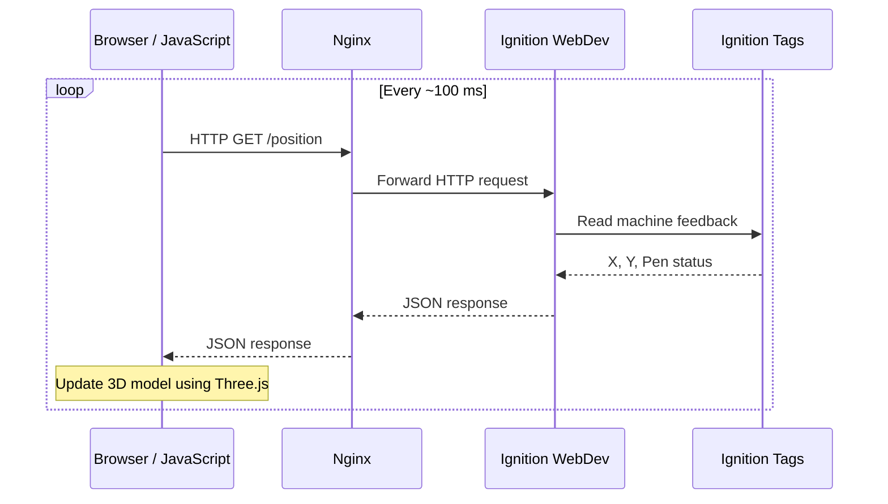
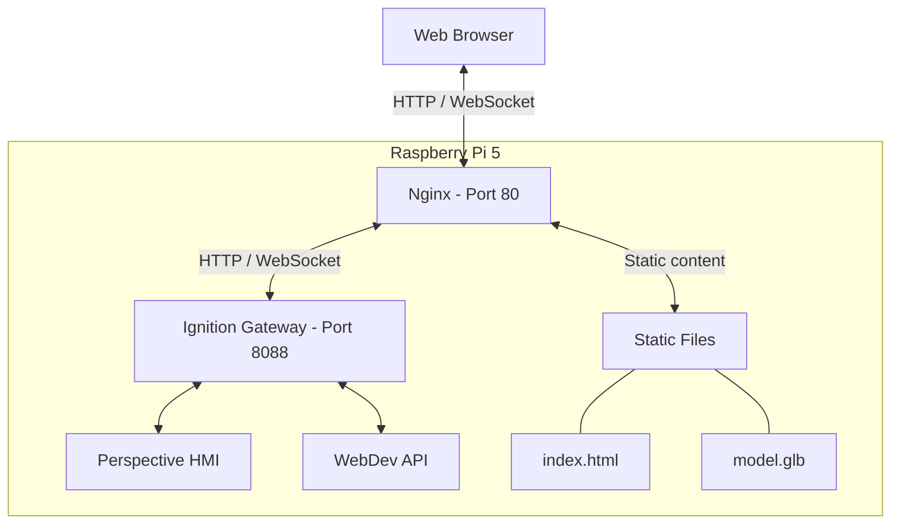

# Communication & System Integration

## Overview

The XY Plotter uses a combination of standard industrial and network protocols to connect the HMI, SoftPLC, database, and motion controller.

The communication architecture separates operator-level data exchange, PLC control, and real-time motion execution.

The Raspberry Pi 5 hosts Ignition Gateway, CODESYS SoftPLC, and PostgreSQL. The ESP32 communicates with CODESYS through an Ethernet W5500 module.

## Communication Overview

| Source | Destination | Protocol | Purpose |
|---|---|---|---|
| Browser | Ignition Gateway | HTTP/HTTPS | Perspective HMI access |
| Ignition | PostgreSQL | JDBC | Drawing storage, configuration, and history |
| Ignition | CODESYS | OPC UA | Commands, trajectory data, and machine feedback |
| CODESYS | ESP32 | TCP/IP | Motion commands and trajectory transfer |
| ESP32 | CODESYS | TCP/IP | Controller status and execution feedback |
| Browser | Nginx | HTTP | HMI and Digital Twin access |
| Nginx | Ignition Gateway | HTTP / WebSocket | Reverse proxy for Perspective and WebDev |
| Digital Twin | Ignition WebDev (via Nginx) | HTTP / JSON | Live machine position and pen status |

## Ignition ↔ PostgreSQL

Ignition communicates with the local PostgreSQL database using JDBC and SQL Named Queries.

The database stores:

- Drawing metadata, G-code, and SVG previews
- Drawing dimensions, point counts, and contour counts
- Communication signal and error catalogs
- Drawing execution history
- Communication and error event logs

The Ignition project also includes startup scripts responsible for creating the required database objects and initializing reference catalogs.

## Ignition ↔ CODESYS — OPC UA

Ignition connects to the CODESYS OPC UA server through the connection named `CodesysOpcUa`.

The connection is used for bidirectional exchange of machine commands, drawing data, operating parameters, and diagnostics.

### Ignition → CODESYS

| Data | Description |
|---|---|
| Operating modes | Automatic and manual operation |
| Machine commands | Start, stop, homing, and other control requests |
| Manual controls | Jogging, target positioning, and pen control |
| Drawing points | Coordinates and point-related parameters |
| Drawing contours | Contour definitions and execution information |
| Drawing parameters | Total points and contours |

### CODESYS → Ignition

| Data | Description |
|---|---|
| Machine status | Operating state and controller status |
| Actual position | Current X/Y coordinates |
| Drawing progress | Current point and execution feedback |
| Buffer status | Number of points in the ESP32 buffer |
| Diagnostics | Communication status and error codes |

The PLC variables are exposed through the CODESYS OPC UA server and mapped to Ignition tags.

## CODESYS ↔ ESP32 — TCP/IP

CODESYS communicates with the ESP32 motion controller through TCP/IP over Ethernet.

The PLC application includes dedicated communication and command-handling logic:

- `FB200_TCP_ESP` — TCP communication
- `FB300_ESP_Cmd` — command handling
- `SND_ESP_Buffer` — outgoing data
- `RCV_ESP_Buffer` — incoming feedback

### PLC → ESP32: Motion Commands

| Field | Description |
|---|---|
| `CommandStw` | Control word (STW) |
| `CommandPointNum` | Drawing point number |
| `CommandContourNum` | Contour number |
| `CommandCoord_X` | Target X coordinate |
| `CommandCoord_Y` | Target Y coordinate |
| `CommandSpeed` | Movement speed |
| `CommandPointFlags` | Point-related execution flags |

### ESP32 → PLC: Motion Feedback

| Field | Description |
|---|---|
| `ResponseZswByte1` | Status word, byte 1 |
| `ResponseZswByte2` | Status word, byte 2 |
| `ResponseCoord_X` | Actual X coordinate |
| `ResponseCoord_Y` | Actual Y coordinate |
| `ResponseCurrPoint` | Current drawing point |
| `ResponsePointsInBuffer` | Buffer occupancy |
| `ResponseNumExpected` | Next expected point number |
| `ResponseLastContRcv` | Last received contour |
| `ResponseLastContDone` | Last completed contour |
| `ResponseErrorCode` | Motion controller error code |
| `ResponseDrawingState` | Drawing execution state |

## Digital Twin ↔ Ignition — HTTP API

The Digital Twin version extends the communication architecture
with an HTTP API implemented using the Ignition WebDev module.

The Three.js application requests machine feedback from
Ignition at 100 ms intervals.

API endpoint:

`/system/webdev/XY_Plotter_SCADA/position`

| Field | Description |
|---|---|
| `x` | Actual X-axis position in mm |
| `y` | Actual Y-axis position in mm |
| `penDown` | Current pen status |

The data is transferred in JSON format and used to update
the 3D model and visualize the drawing trajectory.

### Digital Twin — Data Exchange Sequence

The following sequence diagram illustrates how the Digital Twin
retrieves machine feedback and updates the 3D model.

### Nginx — Reverse Proxy

Nginx runs on the Raspberry Pi 5 and provides a common
web access point for Ignition Perspective and the Digital Twin.

Nginx is responsible for:

- Serving the Digital Twin application and GLB model.
- Forwarding HTTP requests to Ignition Gateway.
- Supporting WebSocket connections for Perspective.
- Providing same-origin access to the WebDev API.

The Digital Twin is used for visualization only and does
not send control commands to the PLC or ESP32.

For more information, see the
[Digital Twin documentation](../digital-twin/README.md).

## Trajectory Transfer and Buffer Management

The motion controller uses a **256-point circular buffer**.

The drawing execution workflow is organized as follows:

1. Ignition retrieves the selected G-code drawing from PostgreSQL.
2. Ignition parses the drawing into structured points and contours.
3. The processed drawing data is transferred to CODESYS through OPC UA.
4. CODESYS coordinates point transmission to the ESP32.
5. The ESP32 stores received points in its circular buffer.
6. The ESP32 executes the trajectory and returns its current status.
7. CODESYS monitors execution progress and buffer feedback.
8. Ignition visualizes the results and stores execution records.

The ESP32 performs motion interpolation and STEP/DIR pulse generation independently of the Raspberry Pi operating system.

## Communication Diagnostics

Ignition Perspective includes an **I/O Monitor** for observing communication between the PLC and motion controller.

The interface provides:

- PLC commands and status signals
- ESP32 response signals
- Current point and contour information
- Actual coordinates and buffer occupancy
- Communication status and cycle information
- Command and response logs
- Error codes and diagnostics

The application also uses PLC heartbeat and communication-loss signals to indicate controller availability.

## Network Configuration

The development installation uses the following services:

| Port | Service |
|---|---|
| 80 | Nginx HTTP — Perspective and Digital Twin access |
| 4840 | CODESYS OPC UA |
| 5432 | PostgreSQL (local access) |
| 8088 | Ignition Gateway HTTP |
| 11740 | CODESYS Runtime communication |

The TCP/IP connection between CODESYS and ESP32 is configured separately within the control application.
Nginx and the WebDev API are required for the Digital Twin version of the project. 
The standard 2D version can be accessed directly through Ignition Gateway on port 8088.

Network addresses and device-specific settings may need to be adjusted when deploying the project on another system.

