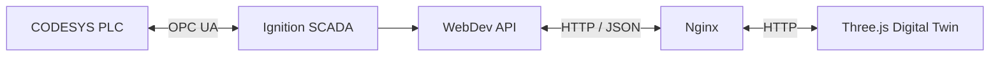

# Digital Twin — 3D Visualization

## Overview

The Digital Twin provides a real-time 3D visualization of the XY Plotter using Three.js and WebGL.

The virtual model is synchronized with the physical machine through Ignition SCADA, displaying the actual axis positions and pen status.

## Main Features

- Interactive 3D machine visualization.
- Real-time X and Y axis position updates.
- Pen and servo movement animation.
- Live drawing trajectory visualization.
- Drawing persistence in the browser.
- Automatic drawing reset when the machine returns to its home position.
- Integration with Ignition Perspective.

## System Architecture

Ignition collects machine feedback through OPC UA and provides the current position and pen status through a WebDev API.

Three.js requests this data every 100 ms and updates the 3D model in the browser.

Nginx serves the 3D application and provides a common access point for Ignition and the Digital Twin.

## Technologies

- Raspberry Pi 5
- CODESYS SoftPLC
- Ignition Perspective
- Ignition WebDev
- Three.js / WebGL
- Nginx
- GLB 3D model

## Screenshots

See the [screenshots](./screenshots/) directory for examples of the Digital Twin and its integration with Ignition Perspective.
