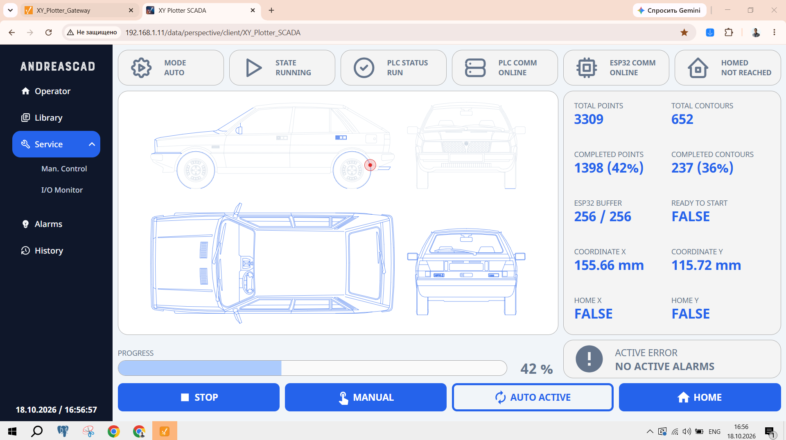
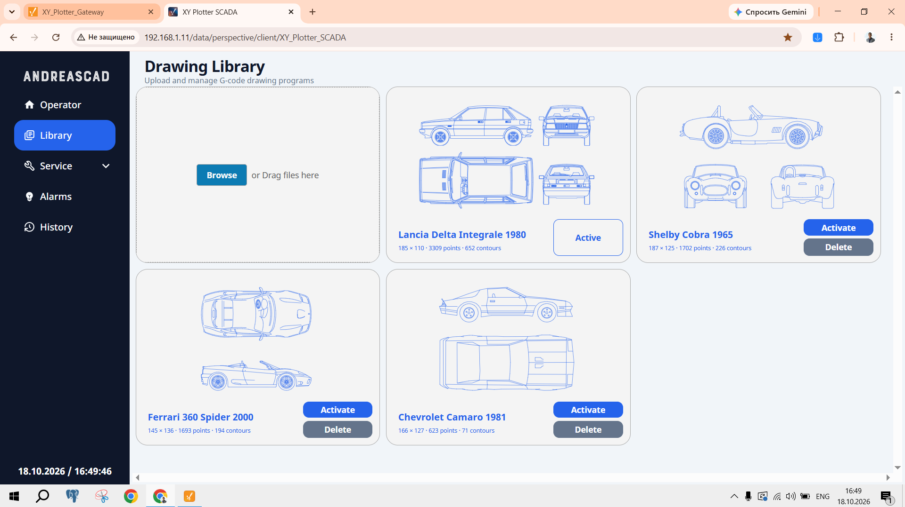
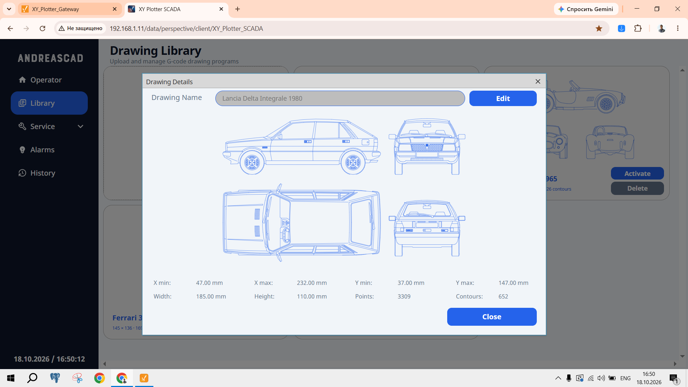
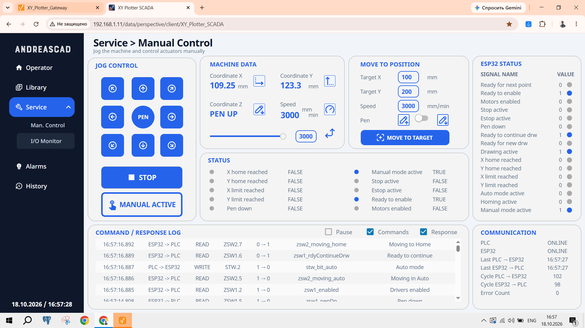
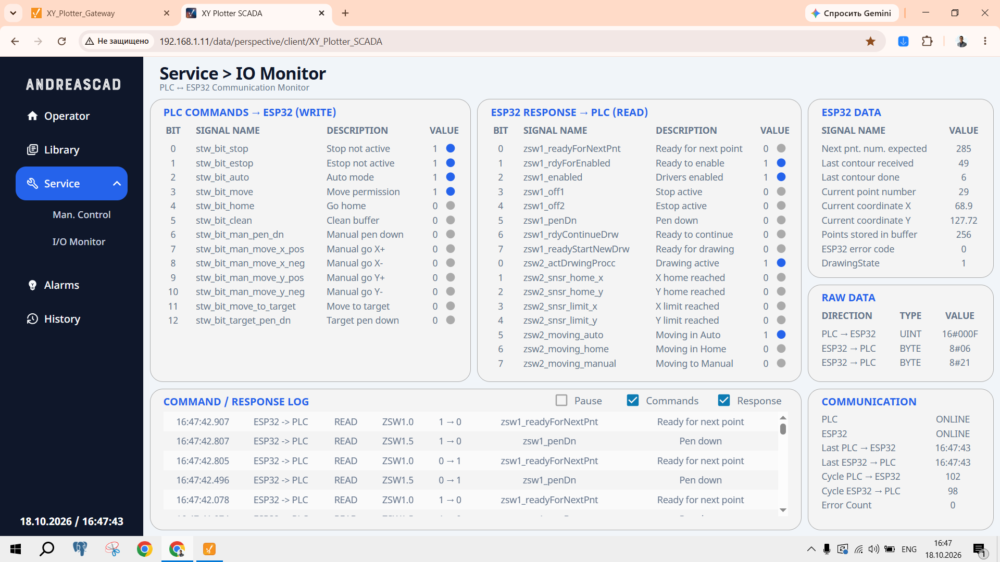
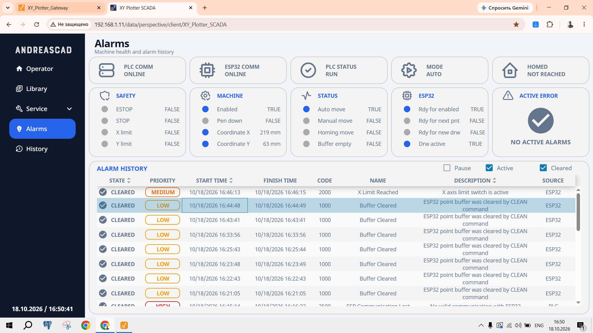
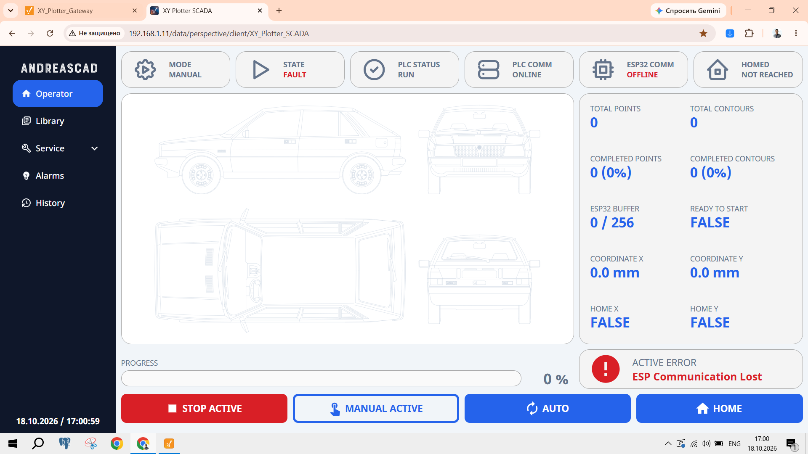
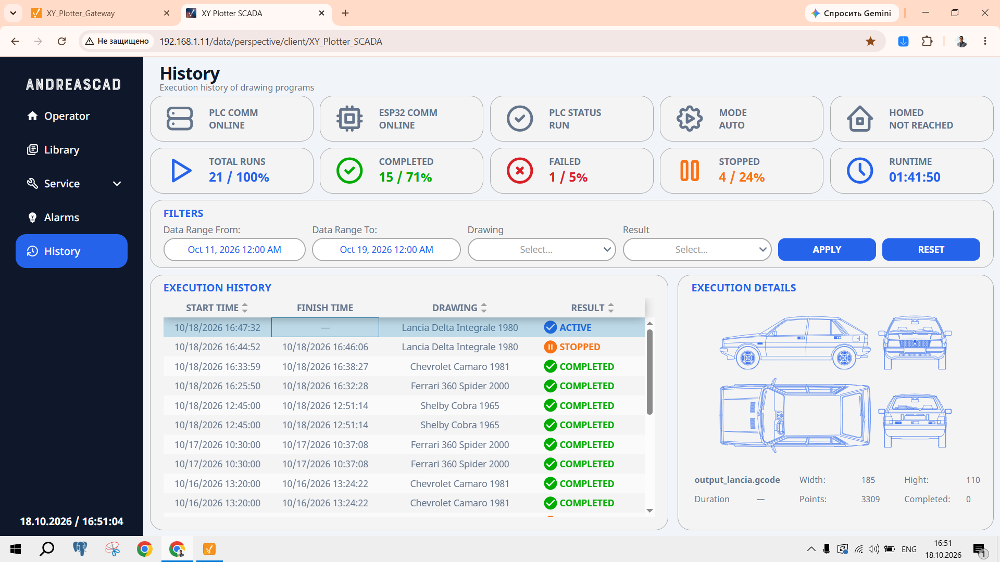

# Ignition Perspective — HMI & SCADA

## Overview

The XY Plotter uses **Ignition 8.3.10 with Perspective** as its web-based HMI and SCADA platform, running on a Raspberry Pi 5.

The application provides machine control, drawing management, real-time visualization, diagnostics, alarm monitoring, and execution history.

Ignition communicates with:

- **CODESYS SoftPLC** through OPC UA for machine commands, trajectory transfer, and feedback.
- **PostgreSQL** through JDBC for drawing storage, configuration, and historical data.

The operator interface is accessible from a web browser without a dedicated HMI panel.

## Perspective Application

### 1. Operator — Automatic Operation

The main operator screen provides real-time drawing visualization and machine control.

Key features:

- Live drawing trajectory and execution progress
- Machine operating mode and status
- PLC and ESP32 communication indicators
- Current coordinates, point and contour counters
- ESP32 buffer occupancy
- Stop, manual/automatic mode selection, and homing commands
- Active error indication

### 2. Drawing Library

The Drawing Library allows operators to upload, preview, activate, and delete G-code drawing programs.

Each drawing includes an SVG preview, dimensions, and point/contour information.

A detailed view displays the drawing preview, coordinate boundaries, dimensions, and trajectory statistics.

### 3. Manual Control

The Manual Control screen provides direct control of the XY Plotter.

Features include:

- Jogging in eight directions
- Manual pen control
- Movement to specified X/Y coordinates
- Movement speed adjustment
- Live position and machine status
- ESP32 status and communication diagnostics

### 4. I/O Monitor

The I/O Monitor provides detailed diagnostics for communication between CODESYS and the ESP32.

It displays:

- PLC control word (STW) signals
- ESP32 status word (ZSW) signals
- Current coordinates, point numbers, and buffer occupancy
- Raw communication data
- Command/response event log
- Communication status and cycle information

### 5. Alarms

The Alarms screen combines live machine diagnostics with historical error records.

It includes machine and safety signals, PLC/ESP32 communication status, active error indication, and a filterable alarm history with priorities, timestamps, descriptions, and sources.

Communication failures are also reflected on the operator screen, including controller offline status and active error messages.

### 6. Execution History

The History screen records drawing execution sessions and their results.

Features include:

- Total runs, completed, failed, and stopped statistics
- Total execution time
- Date, drawing, and result filters
- Execution start and finish timestamps
- Selected drawing preview and execution details

## G-code Processing and Drawing Transfer

Drawing preparation is handled by Ignition project scripts.

The workflow is:

1. Upload a G-code drawing through Perspective.
2. Process the G-code and generate an SVG preview.
3. Store the drawing and metadata in PostgreSQL.
4. Select and activate a drawing from the library.
5. Parse the G-code into structured trajectory points and contours.
6. Transfer the prepared data to CODESYS through OPC UA.
7. Monitor drawing execution using PLC and ESP32 feedback.

The ESP32 performs the actual motion interpolation and STEP/DIR pulse generation.

## Database and Diagnostics

Ignition uses PostgreSQL for persistent storage of drawings, execution history, communication events, and errors.

The application also includes initialization logic for database tables and reference catalogs, including communication signals and error definitions.

Machine diagnostics are available through the Operator, I/O Monitor, and Alarms screens.
