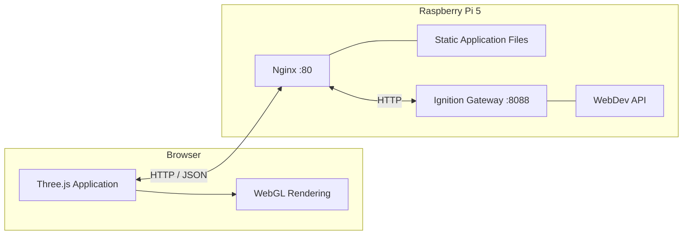

# Digital Twin — Three.js Application

## Overview

This directory contains the source files and deployment configuration
for the interactive 3D Digital Twin of the XY Plotter.

The application is developed using JavaScript, Three.js, and WebGL.
It retrieves actual machine feedback from Ignition through the WebDev
HTTP API and synchronizes the 3D model with the physical machine.

The application runs directly in the client web browser.

## Project Files

| File | Description |
|---|---|
| `index.html` | Three.js application, scene initialization, HTTP polling, model animation, and trajectory rendering |
| `model.glb` | 3D machine model in binary glTF format |
| `nginx.conf` | Nginx configuration for static file hosting and reverse proxy |
| `README.md` | Installation and configuration instructions |

## Requirements

- Raspberry Pi 5 with Linux
- Ignition Gateway 8.3.10
- Ignition Perspective module
- Ignition WebDev module
- Digital Twin version of the `XY_Plotter_SCADA` project
- Nginx
- Web browser with WebGL support

Three.js is loaded from a CDN. Node.js, npm, and a separate
application build process are not required.

## Software Architecture



Nginx serves the static application files and forwards Ignition
requests to the Gateway.

The Raspberry Pi provides the application files and machine data,
while 3D rendering is performed on the client device.

## Installation

### 1. Configure Ignition

Import the Digital Twin version of the Ignition project.

The project must be named:

`XY_Plotter_SCADA`

Make sure the Perspective and WebDev modules are installed
and running.

The standard 2D project and the provided Gateway backup do not
include the Digital Twin WebDev resource.

### 2. Install Nginx

```bash
sudo apt update
sudo apt install nginx
```

### 3. Deploy Application Files

Create the application directory:

```bash
sudo mkdir -p /var/www/html/digital-twin
```

Copy the application files into the directory:

```bash
sudo cp index.html /var/www/html/digital-twin/
sudo cp model.glb /var/www/html/digital-twin/
```

The resulting directory structure should be:

```text
/var/www/html/digital-twin/
├── index.html
└── model.glb
```

### 4. Configure Nginx

Copy the provided Nginx configuration:

```bash
sudo cp nginx.conf /etc/nginx/sites-available/ignition
```

Enable the configuration:

```bash
sudo ln -s /etc/nginx/sites-available/ignition \
    /etc/nginx/sites-enabled/ignition
```

Disable the default Nginx site if it is enabled:

```bash
sudo rm -f /etc/nginx/sites-enabled/default
```

Validate the configuration:

```bash
sudo nginx -t
```

Enable and restart Nginx:

```bash
sudo systemctl enable nginx
sudo systemctl restart nginx
```

Check the service status:

```bash
sudo systemctl status nginx
```

### 5. Access the Application

Open the Digital Twin directly in a web browser:

```text
http://<raspberry-pi-ip>/digital-twin/
```

Access Ignition Gateway through Nginx:

```text
http://<raspberry-pi-ip>/
```

Nginx listens on port 80 and forwards Ignition requests
to the local Gateway on port 8088.

### 6. Configure Perspective Integration

The Digital Twin is embedded in the Perspective Auto screen
using an Inline Frame component.

Configure its source URL according to the Raspberry Pi
IP address or hostname:

```text
http://<raspberry-pi-ip>/digital-twin/index.html
```

Open the Perspective application through Nginx to maintain
a common web origin for the HMI and Digital Twin.

## HTTP API

The application retrieves machine feedback from the following
Ignition WebDev endpoint:

```text
GET /system/webdev/XY_Plotter_SCADA/position
```

Example JSON response:

```json
{
    "x": 125.5,
    "y": 80.2,
    "penDown": true
}
```

| Parameter | Data Type | Description |
|---|---|---|
| `x` | Number | Actual X-axis position in mm |
| `y` | Number | Actual Y-axis position in mm |
| `penDown` | Boolean | Actual pen status |

The application polls the endpoint approximately every 100 ms.

The API provides machine feedback only. It does not execute
machine commands.

## 3D Model Structure

The GLB model contains named objects used by the application
to control individual machine components.

| Object Name | Responsibility |
|---|---|
| `CTRL_X_Axis` | X-axis movement |
| `CTRL_Y_Carriage` | Y-axis movement |
| `CTRL_Pen` | Vertical pen movement |
| `CTRL_ServoArm` | Servo arm rotation |

The model is loaded into browser memory during application
initialization using GLTFLoader.

The initial positions and orientations of the controlled
objects are stored and used as references for subsequent
transformations.

If the GLB model is replaced or modified, these object names
and the corresponding coordinate mappings must be preserved
or updated in the application code.

The original GLB file is not modified during operation.

## Application Logic

The JavaScript application is responsible for:

- Three.js scene and camera initialization
- GLB model loading
- HTTP polling of machine feedback
- X/Y axis position synchronization
- Pen and servo movement animation
- Live drawing trajectory rendering
- Interactive camera controls
- WebGL rendering

Machine feedback acquisition and 3D rendering operate
independently.

The Digital Twin does not modify the existing CODESYS
or ESP32 control logic.

## Troubleshooting

| Problem | Possible Cause |
|---|---|
| Application does not open | Nginx service or configuration issue |
| 3D model does not load | Missing GLB file or incorrect file path |
| Model is visible but does not move | WebDev API unavailable or incorrect project name |
| Inline Frame does not load | Incorrect IP address or hostname |
| Three.js application does not initialize | CDN unavailable or browser compatibility issue |
| Perspective connection issues | Nginx reverse proxy or WebSocket configuration |

Check Nginx configuration and service status:

```bash
sudo nginx -t
sudo systemctl status nginx
```

Check Nginx error logs:

```bash
sudo tail -f /var/log/nginx/error.log
```

Test the WebDev API locally:

```bash
curl http://127.0.0.1:8088/system/webdev/XY_Plotter_SCADA/position
```

Test the API through Nginx:

```bash
curl http://127.0.0.1/system/webdev/XY_Plotter_SCADA/position
```

Use the browser developer tools (Console and Network tabs)
to diagnose JavaScript, model loading, and HTTP request issues.

## Related Documentation

- [Digital Twin Documentation](../../documentation/digital-twin/README.md)
- [System Architecture](../../documentation/architecture/README.md)
- [Communication Architecture](../../documentation/communication/README.md)
- [Ignition Project Files](../hmi/README.md)

## Notes

The Digital Twin is a visualization-only application.

It is not responsible for machine control, motion execution,
interlocks, or safety functions.
